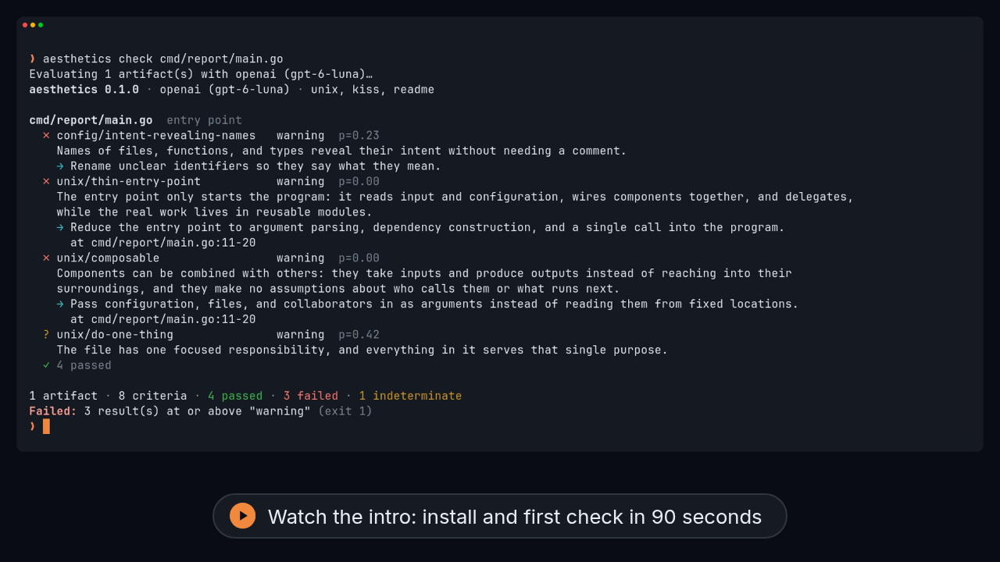

<h1 align="center">
  <picture>
    <source media="(prefers-color-scheme: dark)" srcset="docs/assets/logo-dark.svg">
    
  </picture>
</h1>

<p align="center">
  <b>Make taste explicit.</b><br>
  Aesthetics evaluates code, documentation, and changes against the qualities you care about.
</p>

<p align="center">
  <a href="https://github.com/sadasant/aesthetics/actions/workflows/ci.yml"></a>
  <a href="https://github.com/sadasant/aesthetics/releases"></a>
  <a href="https://pkg.go.dev/github.com/sadasant/aesthetics"></a>
</p>

Linters check what a program can decide. **Aesthetics checks what takes judgment**: clarity, organization, composition, coherence, simplicity.

You write guidelines in plain language, or adopt a school of thought such as `unix`, `kiss`, or `diataxis`. You decide where each one applies. A decision model judges every guideline and reports **pass**, **fail**, or **indeterminate**. Every failure comes with a recommendation and, where it can, the lines that show the problem.

<p align="center">
  <a href="docs/assets/intro.mp4"></a><br>
  <sub>A 90-second narrated intro with subtitles · <a href="docs/assets/intro.srt">transcript</a></sub>
</p>

## Install

```sh
curl -fsSL https://raw.githubusercontent.com/sadasant/aesthetics/main/install.sh | sh
```

The script downloads the release for your macOS or Linux machine, verifies its checksum, and installs it. Prefer something else?

- **Go 1.22+:** `go install github.com/sadasant/aesthetics/cmd/aesthetics@latest`
- **Binaries for macOS, Linux, and Windows:** [Releases](https://github.com/sadasant/aesthetics/releases)

## Quick start

```sh
export OPENAI_API_KEY=…             # or TypeSafe, Cloudflare, a self-hosted Laya, …
aesthetics init --use unix,kiss     # writes .aesthetics.yaml
aesthetics check                    # the whole repository
aesthetics check --diff             # only what you changed
aesthetics explain src/main.go      # which guidelines apply, and why
```

The [tutorial](docs/tutorial.md) walks through a first evaluation in about ten minutes.

## Your taste, written down

```yaml
# .aesthetics.yaml
provider: openai
extends: [unix, kiss, atomic]            # schools of thought, nothing implicit

guidelines:
  - Error messages say what failed and what the user can do about it.

rules:
  - match: "**/README.md"
    extends: [readme]
  - match: "src/**/utils/**"
    guidelines:
      - Avoid abstractions with a single caller.
```

Guidelines can be scoped to paths, file types, directory depths, directories, the whole repository, or Git diffs. Rules compose and specialize them. When schools of thought disagree, the higher-ranked guideline governs, and `explain` shows exactly why.

| Preset | Foundation | Judges |
| --- | --- | --- |
| `unix` | Unix philosophy | Focused responsibilities, simple interfaces, composability |
| `kiss` | Keep It Simple | Directness and the absence of unnecessary complexity |
| `atomic` | Atomic changes | Focused, coherent diffs without unrelated edits |
| `readme` | Standard Readme | Purpose, installation, usage, orientation |
| `diataxis` | Diátaxis | Documentation organized by what readers need |
| `solid` | SOLID | Cohesion, responsibilities, abstractions, dependencies |

## What makes it different

- **Your judgment, not ours.** No guideline is on by default, and no school of thought is treated as universally right.
- **Context, not just files.** It evaluates files by their role (an entry point is not a README), directories by their organization, the repository by its coherence, and diffs as changes.
- **Honest about uncertainty.** Each outcome comes from a calibrated probability. When the model can't decide, the result says so.
- **Fair to your history.** On a diff, every failure is marked as *introduced* by the change or *preexisting*, and by default only introduced problems fail CI.
- **Built for CI.** It runs non-interactively, returns meaningful exit codes, writes a JSON report, and never modifies your files.
- **Measured.** [Evals](evals/README.md) with 104 labeled judgments set its defaults: 97% correct on clear cases with OpenAI and 98% with Cloudflare Clef, with no false failures.

## Documentation

| When you want to | Read |
| --- | --- |
| **Learn** | [Tutorial: your first evaluation](docs/tutorial.md) |
| **Do** | [Write your own guidelines](docs/how-to/write-guidelines.md) · [Check changes in CI](docs/how-to/check-changes-in-ci.md) · [Configure a provider](docs/how-to/configure-a-provider.md) |
| **Look up** | [CLI](docs/reference/cli.md) · [Configuration](docs/reference/configuration.md) · [Presets](docs/reference/presets.md) · [Providers](docs/reference/providers.md) · [Results and exit codes](docs/reference/results.md) |
| **Understand** | [How evaluation works](docs/explanation/how-evaluation-works.md) · [How guidelines compose](docs/explanation/composition.md) |

## Contributing

Issues and pull requests are welcome. Keep changes focused and run `go test ./...`. If a change affects judgments (presets, question wording, or the context sent to models), run `go run ./evals` before and after, and include both summaries. The repository [evaluates itself](.aesthetics.yaml) with `aesthetics check`.

## License

Aesthetics is released under the [MIT License](LICENSE).
